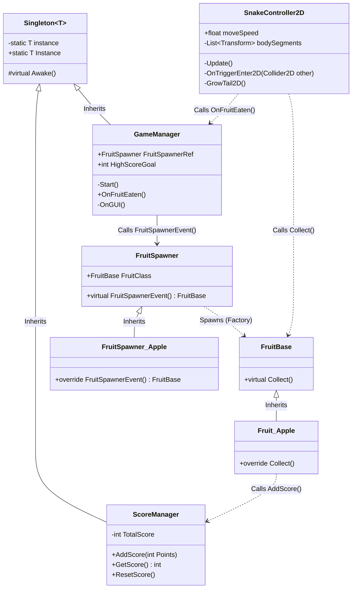

# INFR 3110 Make Up Assignment
---
### Name : Jarell Igene
### Student Number : 100980195
---
# Object Oriented Programming
---

### Description
Object-Oriented Programming is implemented across 4 C# scripts (`GameManager.cs`, `Fruit_Apple.cs`, `FruitSpawner_Apple.cs`, and `SnakeController2D.cs`) following the course lecture architecture:
* **Inheritance:** `FruitBase` serves as the base parent class (Product Interface) containing the virtual `Collect()` method. `Fruit_Apple` inherits from `FruitBase` (`Fruit_Apple : FruitBase`), and `FruitSpawner_Apple` inherits from the base `FruitSpawner` creator class (`FruitSpawner_Apple : FruitSpawner`). Additionally, both `GameManager` and `ScoreManager` inherit from the generic `Singleton<T>` template base class.
* **Polymorphism:** `FruitBase` defines a `public virtual void Collect()` method, which the derived class `Fruit_Apple` overrides using `public override void Collect()` to award 100 points via `ScoreManager.Instance.AddScore(100)`, log the collection event, and destroy the fruit GameObject when `SnakeController2D` triggers `fruit.Collect()` inside `OnTriggerEnter2D`.

## UML Diagram

---
# Singleton Pattern
---

### Purpose
The Singleton pattern restricts the instantiation of a class to a single global object and provides a global point of access to it. In this 2D Snake game, a Singleton is used for managing global game state (`GameManager`) and tracking persistent score (`ScoreManager`). Because `Fruit_Apple` instances are dynamically instantiated and destroyed at runtime by the Factory, they cannot hold manual Inspector references to scene managers. Using the Singleton pattern allows spawned fruit and `SnakeController2D` to safely update the score and trigger the next spawn event globally without tight scene coupling.

### Implementation
Implemented in `GameManager.cs` using the generic C# template class `Singleton<T> : MonoBehaviour where T : Component` in **2 places** as required by the rubric:
1. **`ScoreManager : Singleton<ScoreManager>`:** Manages `TotalScore` and implements `AddScore(int Points)`, `GetScore()`, and `ResetScore()`. Accessed globally via `ScoreManager.Instance.AddScore(100)` inside `Fruit_Apple.Collect()` and read by `GameManager` to display the UI score.
2. **`GameManager : Singleton<GameManager>`:** Holds the `FruitSpawnerRef` reference and High Score challenge state. Accessed globally via `GameManager.Instance.OnFruitEaten()` inside `SnakeController2D.OnTriggerEnter2D()` whenever the snake eats a fruit.

---
# Factory Pattern
---

### Purpose
The Factory Method pattern defines an interface for creating objects in a base creator class (`FruitSpawner`) while allowing subclasses (`FruitSpawner_Apple`) to specify the concrete product (`Fruit_Apple`) to instantiate. Applying the Factory pattern to fruit spawning in Snake decouples `GameManager` and `SnakeController2D` from concrete fruit prefabs and 2D spawn coordinate calculations (`Vector2`). If new fruit types (such as bonus or hazard fruits) are added later, new concrete spawners or products can be swapped in without modifying `GameManager` or `SnakeController2D`.

### Implementation
* **Product Interface (`FruitBase`) & Concrete Product (`Fruit_Apple`):** Defined in `Fruit_Apple.cs`, establishing the `Collect()` interface and concrete score/destruction behavior.
* **Creator (`FruitSpawner`) & Concrete Creator (`FruitSpawner_Apple`):** Defined in `FruitSpawner_Apple.cs`. Holds the `FruitBase FruitClass` reference and implements `FruitSpawnerEvent()`, which calculates a randomized 2D position (`new Vector2(Random.Range(-6f, 6f), Random.Range(-3.5f, 3.5f))`) inside the camera bounds and calls `Instantiate(FruitClass, randomPos, Quaternion.identity)`.
* **Client (`GameManager`):** Holds an Inspector reference to `FruitSpawnerRef` (`FruitSpawner_Apple`) and invokes `FruitSpawnerRef.FruitSpawnerEvent()` on `Start()` and inside `OnFruitEaten()`.

---
# References
---
* INFR 3110 Course Lecture Slides: *Factory Pattern Implementation* & *Singleton Pattern Implementation* (Ontario Tech University)[cite: 29, 58]
* Unity Scripting API Documentation (`MonoBehaviour`, `Instantiate`, `InputSystem`, `Collider2D`)
